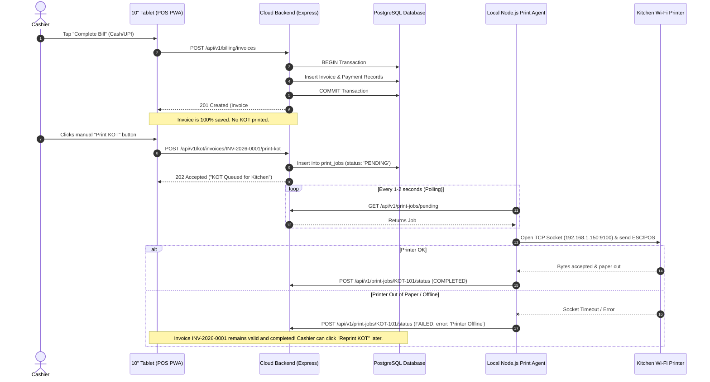

# System Architecture — Cafe Cloud POS

## 1. Architectural Vision & Style

Cafe Cloud POS is designed as a **Modular Monolith** with clean boundaries between sub-domains, paired with an **On-Premise Local Print Daemon** and a **Modern Progressive Web App (PWA)** for the cashier tablet.

### Core Architectural Decisions:
1. **Modular Monolith over Microservices**: All core business logic (Auth, Catalog, Billing, Taxes, Printing, Reporting) runs within a single well-structured Node.js + Express application process. This eliminates distributed transaction complexity, network overhead between services, and container orchestration overhead, while maintaining strict separation of concerns via domain modules.
2. **Decoupled Three-Tier Topology**:
   - **Frontend (PWA)**: Runs in the browser on a 10-inch Android tablet.
   - **Backend (Cloud)**: Centralized cloud-hosted API with PostgreSQL database.
   - **Print Agent (Local LAN Daemon)**: Lightweight local service running inside the shop's local Wi-Fi network.
3. **Server-Authoritative Pricing & Tax Engine**: All financial math (base price, item discounts, CGST, SGST, IGST, invoice total, rounding) is computed solely by the backend. The frontend only suggests quantities and displays calculated numbers returned by the server.
4. **Decoupled Print Queue**: KOT generation is an asynchronous, queue-backed operation. The invoice transaction commits independently of printer availability.

---

## 2. High-Level Architecture Diagram

```mermaid
flowchart TD
    subgraph ClientLayer["Frontend Client Layer (On-Premise)"]
        Tablet["10-Inch Android Tablet\n(React + Vite + PWA)\nCashier POS UI"]
    end

    subgraph CloudLayer["Cloud Hosting Infrastructure"]
        subgraph ModularMonolith["Node.js + Express API (Modular Monolith)"]
            AuthMod["Auth & RBAC Module"]
            BrandMod["Company & Brand Module"]
            CatalogMod["Catalog / Menu Module"]
            BillingMod["Billing & Tax Calculation Engine"]
            PrintMod["Print Queue & KOT Module"]
            ReportMod["Reporting Engine (Brand & Consolidated)"]
            AuditMod["Audit Logging Module"]
        end

        subgraph DataLayer["Relational Persistence"]
            Postgres[("PostgreSQL Database\n- Migrations (node-pg-migrate)\n- ACID Transactions\n- Multi-Tenant Ready Schema")]
        end
    end

    subgraph ShopLAN["Local Store Network (Wi-Fi LAN)"]
        PrintAgent["Local Print Agent\n(Node.js Background Daemon)"]
        WifiPrinter["Kitchen Wi-Fi Thermal Printer\n(ESC/POS over TCP 9100)"]
    end

    %% Communication Links
    Tablet -->|HTTPS / WSS (JWT Auth)| ModularMonolith
    ModularMonolith <-->|Connection Pool / SQL| Postgres
    PrintAgent -->|HTTPS Long-Poll / SSE (Agent API Key)| PrintMod
    PrintAgent -->|Raw TCP Socket (ESC/POS)| WifiPrinter
```

---

## 3. Modular Monolith Sub-Domains

The backend codebase is organized strictly into cohesive modules. Each module encapsulates its own controllers, services, repositories, and validation rules:

```
backend/src/modules/
├── auth/          # JWT authentication, password hashing, role checks
├── companies/     # Company profile, legal registration, GSTIN, multi-tenant context
├── brands/        # Brand configurations (Cafe Company vs Brownie Shop)
├── catalog/       # Categories, items, variants, HSN codes, active status
├── billing/       # Server-side tax & price calculations, invoices, payments
├── kot/           # Manual KOT generation, ticket formatting
├── printing/      # Print job queue management, agent polling API, status updates
├── reports/       # Brand-wise and consolidated analytical queries
└── audit/         # Immutable audit event recorder
```

### Module Responsibilities

| Module | Core Responsibility | External Dependencies |
| :--- | :--- | :--- |
| **`auth`** | Issues and validates access & refresh tokens; verifies RBAC permissions | Users repository |
| **`companies` & `brands`** | Manages company legal details (GSTIN) and child brands (Cafe Company & Brownie Shop) | Database |
| **`catalog`** | Product catalog mapped to brands; stores prices and HSN/tax codes | Brands module |
| **`billing`** | Pure mathematical calculations for line items, CGST/SGST splitting, and atomic invoice creation | Catalog, Audit modules |
| **`kot`** | Formats kitchen ticket payloads upon explicit cashier manual trigger | Billing module |
| **`printing`** | Dispatches print jobs, tracks print status (`PENDING`, `PRINTING`, `COMPLETED`, `FAILED`) | KOT module |
| **`reports`** | Aggregates daily/periodic sales, split by brand and consolidated | Billing module |
| **`audit`** | Logs security events, invoice voids, and administrative actions | Global |

---

## 4. On-Premise Local Print Agent

### Why a Local Agent is Required
Cloud-hosted servers cannot directly initiate a TCP connection to a local Wi-Fi printer possessing a private IP address (e.g., `192.168.1.150:9100`) located behind a commercial retail router without complex VPNs or risky port forwarding. 

### Agent Mechanics:
1. **Lightweight Daemon**: Built with Node.js, running on any low-power device connected to the shop Wi-Fi (mini PC, Raspberry Pi, or local counter computer).
2. **Outbound Polling / Long-Polling**: The agent initiates outbound HTTPS connections to the Cloud API endpoint:
   `GET /api/v1/print-jobs/pending`
3. **Mutual Agent Authentication**: The agent authenticates using a securely provisioned, rotating `X-Agent-Secret` API key.
4. **Local Network Socket**: Upon receiving a print job payload, the agent opens a direct TCP socket connection (`net.Socket`) to the kitchen printer on port 9100.
5. **ESC/POS Generation**: Translates ticket data into standard ESC/POS binary commands (bold headers, paper cut, line feeds).
6. **Status Feedback**: Sends completion or failure signals back to the cloud:
   `POST /api/v1/print-jobs/:id/status` with status `COMPLETED` or `FAILED`.

---

## 5. Multi-Company Isolation Strategy (Future Readiness)

Although the business operates a single company initially, the architecture ensures future multi-tenant or multi-company expansion without redesigning tables:

1. **Mandatory Tenant Scoping**: All relational tables (`brands`, `products`, `invoices`, `users`, `print_jobs`) contain a mandatory `company_id UUID` column with a foreign key constraint.
2. **Contextual Request Scoping**: An Express middleware (`tenantContextMiddleware`) extracts the authenticated user's `company_id` from the JWT token and attaches it to `req.tenantContext`.
3. **Repository-Level Filtering**: All database queries automatically append `WHERE company_id = $tenantId` to prevent cross-tenant data leakage.
4. **Row-Level Security (RLS) Ready**: The PostgreSQL schema is structured so PostgreSQL RLS policies can be activated seamlessly if required.

---

## 6. Server-Side Financial Calculation Engine

To prevent tampering, price discrepancies, and rounding errors, **all calculations are server-authoritative**:

1. **Data Types**: All financial values are stored and calculated as `NUMERIC(12, 2)` in PostgreSQL and represented with high-precision decimal libraries (e.g., `decimal.js`) in Node.js. JavaScript native floating-point numbers (`Number`) are strictly forbidden for financial calculations.
2. **GST Splitting Algorithm**:
   - Each product has an associated GST rate (e.g., 5%).
   - Intra-state sales split the rate equally into CGST (2.5%) and SGST (2.5%).
   - Rounding to 2 decimal places occurs at the line-item level using standard Half-Up rounding, ensuring line-item sum equals grand total.
3. **Client Role**: The tablet client calculates an approximate preview for UI feedback, but upon payment submission, the backend re-calculates all values from database product records. If a price mismatch occurs (e.g., price changed during checkout), the backend rejects the transaction with a clear error.

---

## 7. Decoupled Resilience Pattern (Invoice vs. KOT)



