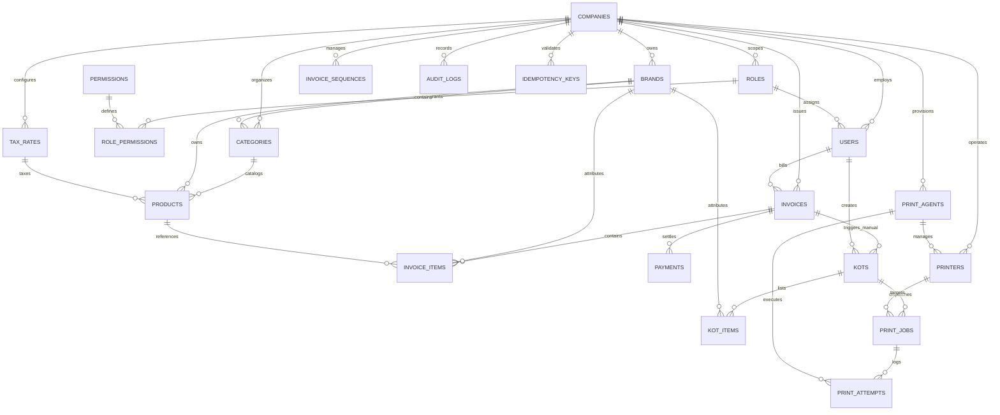

# Database Design Specification — Cafe Cloud POS

> **Phase 2.1 Finalized Database Blueprint**  
> **Status**: Comprehensive Design Ready for Review.  
> **Rule Adherence**: No database migrations, tables, or application code have been created yet. Tables will be materialized via migrations in Phase 2.2 upon approval.

---

## 1. Architectural Principles & PostgreSQL Conventions

1. **Relational Database Engine**: PostgreSQL 15+ leveraging full ACID transactional guarantees, foreign key constraints, and row-level locking.
2. **Company-Level Tenant Isolation**: Every tenant-scoped entity contains `company_id UUID NOT NULL REFERENCES companies(id) ON DELETE RESTRICT`. All queries must filter by `company_id`.
3. **Monetary Precision**: All currency amounts are defined as `NUMERIC(12, 2)` (supporting figures up to ₹9,999,999,999.99). Fractional rates and percentages use `NUMERIC(5, 2)`. JavaScript native floating-point math is strictly forbidden.
4. **Primary Keys**: UUID v4 (`UUID DEFAULT gen_random_uuid()`) for distributed safety, clean multi-company federation, and non-enumerable IDs.
5. **Timestamp Consistency**: All date-times are stored as `TIMESTAMPTZ` (`TIMESTAMP WITH TIME ZONE`) in UTC.
6. **Immutable Historical Snapshots**: Invoices, line items, and KOT items permanently store immutable snapshots of brand names, product titles, prices, HSN/SAC codes, and GST percentages at the moment of billing. Modifying a catalog item never alters historic invoices.
7. **Two-Phase Decoupled Billing vs. KOT**: Invoices commit atomically with payments. KOT generation is an independent, subsequent manual cashier action. Print job failures have zero transactional link to customer invoices.

---

## 2. Entity-Relationship Diagram (ERD)



---

## 3. Complete Table Inventory (21 Tables in 10 Functional Groups)

| # | Group | Table Name | Description |
| :--- | :--- | :--- | :--- |
| 1 | **Companies & Brands** | `companies` | Legal commercial entity holding the single GSTIN and business address. |
| 2 | | `brands` | Operating brands: Cafe Company (`CC`) and Brownie Shop (`BS`). |
| 3 | **Users, Roles & RBAC** | `roles` | System and tenant-level roles (Cashier, Store Manager, Admin). |
| 4 | | `permissions` | Atomic system actions (e.g., `billing.create`, `kot.print_manual`). |
| 5 | | `role_permissions` | Many-to-many relationship mapping roles to specific permissions. |
| 6 | | `users` | System staff, cashiers, and managers with hashed credentials and PINs. |
| 7 | **Tax Rates** | `tax_rates` | Configurable GST rates (e.g. 5%, 12%, 18%, 0%) with CGST/SGST/IGST splits. |
| 8 | **Categories & Products**| `categories` | Product groupings linked to brands (e.g., Cold Brews, Brownies). |
| 9 | | `products` | Menu items with prices, brand assignments, HSN codes, and tax rates. |
| 10| **Invoices & Items** | `invoice_sequences` | Concurrency-safe atomic counter for gapless invoice numbering per FY. |
| 11| | `invoices` | Consolidated customer tax invoices with company & tax snapshots. |
| 12| | `invoice_items` | Individual line items with frozen brand, product, price, and GST snapshots. |
| 13| **Payments** | `payments` | Financial settlements per bill (Cash, UPI, Card) with change tracking. |
| 14| **KOTs & Items** | `kots` | Kitchen tickets generated **strictly upon manual cashier action**. |
| 15| | `kot_items` | Preparation items sent to the kitchen (omitting all financial numbers). |
| 16| **Printers & Agents** | `print_agents` | Registered on-premise Node.js daemon instances per store. |
| 17| | `printers` | Physical/Wi-Fi thermal hardware endpoints (IP, port 9100, paper width). |
| 18| **Print Jobs & Attempts**| `print_jobs` | Decoupled queue for KOT printing with safe lease locking & recovery. |
| 19| | `print_attempts` | Diagnostic execution log of every socket dispatch by the print agent. |
| 20| **Audit & Reliability** | `audit_logs` | Append-only immutable log of financial, security, and override actions. |
| 21| | `idempotency_keys` | Request deduplication store preventing double billing from tablet drops. |

---

## 4. Detailed Table Schema Definitions

### 4.1 Group 1: Companies and Brands

#### `companies`
Stores the single parent legal entity.
```sql
CREATE TABLE companies (
    id UUID PRIMARY KEY DEFAULT gen_random_uuid(),
    legal_name VARCHAR(150) NOT NULL,
    trade_name VARCHAR(150),
    gstin VARCHAR(15) NOT NULL UNIQUE,          -- 15-character statutory Indian GSTIN
    pan VARCHAR(10),                            -- Permanent Account Number (chars 3 to 12 of GSTIN)
    phone VARCHAR(20) NOT NULL,
    email VARCHAR(100),
    address_line1 TEXT NOT NULL,
    address_line2 TEXT,
    city VARCHAR(50) NOT NULL,
    state_name VARCHAR(50) NOT NULL,
    state_code VARCHAR(2) NOT NULL DEFAULT '32', -- 2-digit Indian state code (e.g., '32' for Kerala)
    pincode VARCHAR(10) NOT NULL,
    currency_code VARCHAR(3) NOT NULL DEFAULT 'INR',
    is_active BOOLEAN NOT NULL DEFAULT TRUE,
    created_at TIMESTAMPTZ NOT NULL DEFAULT CURRENT_TIMESTAMP,
    updated_at TIMESTAMPTZ NOT NULL DEFAULT CURRENT_TIMESTAMP
);
```

#### `brands`
Child brands operating under the single company.
```sql
CREATE TABLE brands (
    id UUID PRIMARY KEY DEFAULT gen_random_uuid(),
    company_id UUID NOT NULL REFERENCES companies(id) ON DELETE RESTRICT,
    name VARCHAR(100) NOT NULL,                 -- 'Cafe Company' or 'Brownie Shop'
    code VARCHAR(10) NOT NULL,                  -- 'CC' or 'BS'
    description TEXT,
    display_order INT NOT NULL DEFAULT 0,
    is_active BOOLEAN NOT NULL DEFAULT TRUE,
    created_at TIMESTAMPTZ NOT NULL DEFAULT CURRENT_TIMESTAMP,
    updated_at TIMESTAMPTZ NOT NULL DEFAULT CURRENT_TIMESTAMP,
    CONSTRAINT uq_brands_company_code UNIQUE (company_id, code),
    CONSTRAINT uq_brands_company_name UNIQUE (company_id, name)
);
```

---

### 4.2 Group 2: Users, Roles, and Permissions

#### `roles`
Predefined and tenant-configurable roles.
```sql
CREATE TABLE roles (
    id UUID PRIMARY KEY DEFAULT gen_random_uuid(),
    company_id UUID REFERENCES companies(id) ON DELETE CASCADE, -- NULL for global system roles
    code VARCHAR(30) NOT NULL,                  -- 'ADMIN', 'STORE_MANAGER', 'CASHIER'
    name VARCHAR(50) NOT NULL,
    description TEXT,
    is_system BOOLEAN NOT NULL DEFAULT FALSE,
    created_at TIMESTAMPTZ NOT NULL DEFAULT CURRENT_TIMESTAMP,
    CONSTRAINT uq_roles_company_code UNIQUE (company_id, code)
);
```

#### `permissions`
Granular authorization privileges.
```sql
CREATE TABLE permissions (
    id UUID PRIMARY KEY DEFAULT gen_random_uuid(),
    code VARCHAR(50) NOT NULL UNIQUE,           -- e.g. 'billing.create', 'kot.print_manual'
    module VARCHAR(30) NOT NULL,                -- 'billing', 'kot', 'catalog', 'reports', 'admin'
    description TEXT,
    created_at TIMESTAMPTZ NOT NULL DEFAULT CURRENT_TIMESTAMP
);
```

#### `role_permissions`
Join table mapping roles to specific permissions.
```sql
CREATE TABLE role_permissions (
    role_id UUID NOT NULL REFERENCES roles(id) ON DELETE CASCADE,
    permission_id UUID NOT NULL REFERENCES permissions(id) ON DELETE CASCADE,
    created_at TIMESTAMPTZ NOT NULL DEFAULT CURRENT_TIMESTAMP,
    PRIMARY KEY (role_id, permission_id)
);
```

#### `users`
Counter cashiers, managers, and administrators.
```sql
CREATE TABLE users (
    id UUID PRIMARY KEY DEFAULT gen_random_uuid(),
    company_id UUID NOT NULL REFERENCES companies(id) ON DELETE RESTRICT,
    role_id UUID NOT NULL REFERENCES roles(id) ON DELETE RESTRICT,
    username VARCHAR(50) NOT NULL,
    password_hash VARCHAR(255) NOT NULL,        -- Argon2id or bcrypt hash
    pin_hash VARCHAR(255),                      -- Hashed 4-6 digit numeric PIN for tablet unlock
    full_name VARCHAR(100) NOT NULL,
    phone VARCHAR(20),
    email VARCHAR(100),
    is_active BOOLEAN NOT NULL DEFAULT TRUE,
    created_at TIMESTAMPTZ NOT NULL DEFAULT CURRENT_TIMESTAMP,
    updated_at TIMESTAMPTZ NOT NULL DEFAULT CURRENT_TIMESTAMP,
    CONSTRAINT uq_users_company_username UNIQUE (company_id, username)
);
```

---

### 4.3 Group 3: Tax Rates

#### `tax_rates`
Statutory GST rate configurations. Products link to these rates to support distinct taxation.
```sql
CREATE TABLE tax_rates (
    id UUID PRIMARY KEY DEFAULT gen_random_uuid(),
    company_id UUID NOT NULL REFERENCES companies(id) ON DELETE RESTRICT,
    name VARCHAR(50) NOT NULL,                  -- e.g., 'GST 5%', 'GST 18%', 'GST 12%', 'Exempt 0%'
    rate_percentage NUMERIC(5, 2) NOT NULL CHECK (rate_percentage >= 0),
    cgst_rate NUMERIC(5, 2) NOT NULL CHECK (cgst_rate >= 0),
    sgst_rate NUMERIC(5, 2) NOT NULL CHECK (sgst_rate >= 0),
    igst_rate NUMERIC(5, 2) NOT NULL CHECK (igst_rate >= 0),
    cess_rate NUMERIC(5, 2) NOT NULL DEFAULT 0.00 CHECK (cess_rate >= 0),
    is_active BOOLEAN NOT NULL DEFAULT TRUE,
    description TEXT,
    created_at TIMESTAMPTZ NOT NULL DEFAULT CURRENT_TIMESTAMP,
    CONSTRAINT uq_tax_rates_company_rate UNIQUE (company_id, rate_percentage, cess_rate)
);
```

---

### 4.4 Group 4: Categories and Products

#### `categories`
Product groupings segmented by brand.
```sql
CREATE TABLE categories (
    id UUID PRIMARY KEY DEFAULT gen_random_uuid(),
    company_id UUID NOT NULL REFERENCES companies(id) ON DELETE RESTRICT,
    brand_id UUID NOT NULL REFERENCES brands(id) ON DELETE RESTRICT,
    name VARCHAR(100) NOT NULL,
    display_order INT NOT NULL DEFAULT 0,
    is_active BOOLEAN NOT NULL DEFAULT TRUE,
    created_at TIMESTAMPTZ NOT NULL DEFAULT CURRENT_TIMESTAMP,
    updated_at TIMESTAMPTZ NOT NULL DEFAULT CURRENT_TIMESTAMP,
    CONSTRAINT uq_categories_brand_name UNIQUE (brand_id, name)
);
```

#### `products`
The saleable menu items with product-specific tax rates, HSN codes, and brand assignment.
```sql
CREATE TABLE products (
    id UUID PRIMARY KEY DEFAULT gen_random_uuid(),
    company_id UUID NOT NULL REFERENCES companies(id) ON DELETE RESTRICT,
    brand_id UUID NOT NULL REFERENCES brands(id) ON DELETE RESTRICT,
    category_id UUID NOT NULL REFERENCES categories(id) ON DELETE RESTRICT,
    tax_rate_id UUID NOT NULL REFERENCES tax_rates(id) ON DELETE RESTRICT,
    name VARCHAR(150) NOT NULL,
    sku VARCHAR(50),
    hsn_sac_code VARCHAR(10) NOT NULL DEFAULT '996331', -- Restaurant service (996331) or Goods (e.g. 1905)
    base_price NUMERIC(12, 2) NOT NULL CHECK (base_price >= 0),
    is_tax_inclusive BOOLEAN NOT NULL DEFAULT TRUE,     -- Retail menu price includes GST
    is_kitchen_item BOOLEAN NOT NULL DEFAULT TRUE,     -- If false, excluded from KOT (e.g. packaged bottles)
    is_active BOOLEAN NOT NULL DEFAULT TRUE,
    created_at TIMESTAMPTZ NOT NULL DEFAULT CURRENT_TIMESTAMP,
    updated_at TIMESTAMPTZ NOT NULL DEFAULT CURRENT_TIMESTAMP,
    CONSTRAINT uq_products_company_sku UNIQUE (company_id, sku)
);
```

---

### 4.5 Group 5: Invoices and Invoice Items

#### `invoice_sequences`
Ensures safe, atomic, gapless sequential invoice numbering under concurrent cashier checkouts.
```sql
CREATE TABLE invoice_sequences (
    id UUID PRIMARY KEY DEFAULT gen_random_uuid(),
    company_id UUID NOT NULL REFERENCES companies(id) ON DELETE RESTRICT,
    financial_year VARCHAR(10) NOT NULL,        -- '2026-27'
    prefix VARCHAR(10) NOT NULL DEFAULT 'INV',
    current_number BIGINT NOT NULL DEFAULT 0,
    created_at TIMESTAMPTZ NOT NULL DEFAULT CURRENT_TIMESTAMP,
    updated_at TIMESTAMPTZ NOT NULL DEFAULT CURRENT_TIMESTAMP,
    CONSTRAINT uq_invoice_sequences_company_fy UNIQUE (company_id, financial_year, prefix)
);
```

#### `invoices`
Consolidated fiscal tax invoices containing items from Cafe Company and Brownie Shop.
```sql
CREATE TABLE invoices (
    id UUID PRIMARY KEY DEFAULT gen_random_uuid(),
    company_id UUID NOT NULL REFERENCES companies(id) ON DELETE RESTRICT,
    cashier_id UUID NOT NULL REFERENCES users(id) ON DELETE RESTRICT,
    invoice_number VARCHAR(50) NOT NULL,        -- Generated atomically, e.g. 'INV/2026-27/00042'
    financial_year VARCHAR(10) NOT NULL,        -- '2026-27'
    counter_code VARCHAR(20) NOT NULL DEFAULT 'COUNTER-01',

    -- IMMUTABLE LEGAL SNAPSHOT: Company details at moment of invoice creation
    company_legal_name_snapshot VARCHAR(150) NOT NULL,
    company_trade_name_snapshot VARCHAR(150),
    company_gstin_snapshot VARCHAR(15) NOT NULL,
    company_address_snapshot TEXT NOT NULL,
    company_state_code_snapshot VARCHAR(2) NOT NULL,
    cashier_name_snapshot VARCHAR(100) NOT NULL,

    -- FINANCIAL AGGREGATES
    subtotal_gross NUMERIC(12, 2) NOT NULL,     -- Sum of gross line amounts
    total_discount_amount NUMERIC(12, 2) NOT NULL DEFAULT 0.00,
    total_taxable_amount NUMERIC(12, 2) NOT NULL, -- Sum of net taxable values
    total_cgst_amount NUMERIC(12, 2) NOT NULL DEFAULT 0.00,
    total_sgst_amount NUMERIC(12, 2) NOT NULL DEFAULT 0.00,
    total_igst_amount NUMERIC(12, 2) NOT NULL DEFAULT 0.00,
    total_cess_amount NUMERIC(12, 2) NOT NULL DEFAULT 0.00,
    rounding_adjustment NUMERIC(6, 2) NOT NULL DEFAULT 0.00, -- Rounded to nearest rupee
    grand_total NUMERIC(12, 2) NOT NULL,

    is_interstate BOOLEAN NOT NULL DEFAULT FALSE, -- False = intra-state (CGST+SGST), True = IGST
    payment_status VARCHAR(20) NOT NULL DEFAULT 'PAID' CHECK (payment_status IN ('PENDING', 'PAID', 'VOIDED', 'REFUNDED')),
    void_reason TEXT,
    voided_by_user_id UUID REFERENCES users(id) ON DELETE RESTRICT,
    voided_at TIMESTAMPTZ,
    notes TEXT,
    created_at TIMESTAMPTZ NOT NULL DEFAULT CURRENT_TIMESTAMP,
    CONSTRAINT uq_invoices_company_number UNIQUE (company_id, invoice_number)
);
```

#### `invoice_items`
Detailed line-item snapshot attributing revenue to specific brands with exact tax calculations.
```sql
CREATE TABLE invoice_items (
    id UUID PRIMARY KEY DEFAULT gen_random_uuid(),
    company_id UUID NOT NULL REFERENCES companies(id) ON DELETE RESTRICT,
    invoice_id UUID NOT NULL REFERENCES invoices(id) ON DELETE CASCADE,
    product_id UUID NOT NULL REFERENCES products(id) ON DELETE RESTRICT,
    brand_id UUID NOT NULL REFERENCES brands(id) ON DELETE RESTRICT,

    -- IMMUTABLE ITEM & BRAND SNAPSHOT
    brand_name_snapshot VARCHAR(100) NOT NULL,  -- 'Cafe Company' or 'Brownie Shop'
    brand_code_snapshot VARCHAR(10) NOT NULL,   -- 'CC' or 'BS'
    item_name_snapshot VARCHAR(150) NOT NULL,
    sku_snapshot VARCHAR(50),
    hsn_sac_code_snapshot VARCHAR(10) NOT NULL,
    is_kitchen_item_snapshot BOOLEAN NOT NULL DEFAULT TRUE,

    -- QUANTITY & VALUE ARITHMETIC
    quantity INT NOT NULL CHECK (quantity > 0),
    unit_price NUMERIC(12, 2) NOT NULL,         -- Effective unit price
    gross_amount NUMERIC(12, 2) NOT NULL,       -- quantity * unit_price
    discount_amount NUMERIC(12, 2) NOT NULL DEFAULT 0.00,
    taxable_value NUMERIC(12, 2) NOT NULL,      -- Base value subject to GST
    
    -- TAX BREAKDOWN SNAPSHOT
    tax_rate_percentage NUMERIC(5, 2) NOT NULL,
    cgst_rate NUMERIC(5, 2) NOT NULL DEFAULT 0.00,
    cgst_amount NUMERIC(12, 2) NOT NULL DEFAULT 0.00,
    sgst_rate NUMERIC(5, 2) NOT NULL DEFAULT 0.00,
    sgst_amount NUMERIC(12, 2) NOT NULL DEFAULT 0.00,
    igst_rate NUMERIC(5, 2) NOT NULL DEFAULT 0.00,
    igst_amount NUMERIC(12, 2) NOT NULL DEFAULT 0.00,
    line_total NUMERIC(12, 2) NOT NULL,         -- taxable_value + cgst + sgst + igst
    notes TEXT                                  -- Line-item customization notes
);
```

---

### 4.6 Group 6: Payments

#### `payments`
Tender settlement records linked to completed invoices.
```sql
CREATE TABLE payments (
    id UUID PRIMARY KEY DEFAULT gen_random_uuid(),
    company_id UUID NOT NULL REFERENCES companies(id) ON DELETE RESTRICT,
    invoice_id UUID NOT NULL REFERENCES invoices(id) ON DELETE RESTRICT,
    payment_method VARCHAR(20) NOT NULL CHECK (payment_method IN ('CASH', 'UPI', 'CARD', 'OTHER')),
    amount NUMERIC(12, 2) NOT NULL CHECK (amount > 0),
    tendered_amount NUMERIC(12, 2),              -- Cash handed over by customer
    change_returned NUMERIC(12, 2) DEFAULT 0.00, -- Cash change returned to customer
    transaction_reference VARCHAR(100),          -- UPI UTR number or Card auth slip code
    status VARCHAR(20) NOT NULL DEFAULT 'SUCCESS' CHECK (status IN ('SUCCESS', 'FAILED', 'REFUNDED')),
    created_at TIMESTAMPTZ NOT NULL DEFAULT CURRENT_TIMESTAMP
);
```

---

### 4.7 Group 7: KOTs and KOT Items

#### `kots`
Created **exclusively when cashier manually clicks the "Print KOT" button**. Never generated automatically.
```sql
CREATE TABLE kots (
    id UUID PRIMARY KEY DEFAULT gen_random_uuid(),
    company_id UUID NOT NULL REFERENCES companies(id) ON DELETE RESTRICT,
    invoice_id UUID NOT NULL REFERENCES invoices(id) ON DELETE RESTRICT,
    kot_number VARCHAR(30) NOT NULL,             -- e.g. 'KOT-2026-00042'
    cashier_id UUID NOT NULL REFERENCES users(id) ON DELETE RESTRICT,
    is_reprint BOOLEAN NOT NULL DEFAULT FALSE,
    reprint_of_kot_id UUID REFERENCES kots(id) ON DELETE SET NULL, -- Original KOT reference if reprint
    reprint_count INT NOT NULL DEFAULT 0,
    reprint_reason TEXT,                         -- Mandatory explanation if reprint is triggered
    created_at TIMESTAMPTZ NOT NULL DEFAULT CURRENT_TIMESTAMP,
    CONSTRAINT uq_kots_company_number UNIQUE (company_id, kot_number)
);
```

#### `kot_items`
Preparation line items dispatched to the kitchen printer. **Omits all financial values and GST amounts**.
```sql
CREATE TABLE kot_items (
    id UUID PRIMARY KEY DEFAULT gen_random_uuid(),
    kot_id UUID NOT NULL REFERENCES kots(id) ON DELETE CASCADE,
    invoice_item_id UUID REFERENCES invoice_items(id) ON DELETE RESTRICT,
    brand_id UUID NOT NULL REFERENCES brands(id) ON DELETE RESTRICT,
    brand_name_snapshot VARCHAR(100) NOT NULL,  -- e.g. 'Cafe Company' or 'Brownie Shop'
    item_name_snapshot VARCHAR(150) NOT NULL,
    quantity INT NOT NULL CHECK (quantity > 0),
    preparation_notes TEXT                       -- e.g. "Warm up", "Extra hot espresso", "No sugar"
);
```

---

### 4.8 Group 8: Printers and Print Agents

#### `print_agents`
On-premise local Node.js daemon running on the store LAN.
```sql
CREATE TABLE print_agents (
    id UUID PRIMARY KEY DEFAULT gen_random_uuid(),
    company_id UUID NOT NULL REFERENCES companies(id) ON DELETE RESTRICT,
    agent_code VARCHAR(50) NOT NULL,             -- e.g. 'AGENT-STORE-01'
    agent_name VARCHAR(100) NOT NULL,
    api_key_hash VARCHAR(255) NOT NULL,          -- Hashed token for authenticating polling requests
    last_heartbeat_at TIMESTAMPTZ,
    ip_address VARCHAR(45),
    is_active BOOLEAN NOT NULL DEFAULT TRUE,
    created_at TIMESTAMPTZ NOT NULL DEFAULT CURRENT_TIMESTAMP,
    updated_at TIMESTAMPTZ NOT NULL DEFAULT CURRENT_TIMESTAMP,
    CONSTRAINT uq_print_agents_company_code UNIQUE (company_id, agent_code)
);
```

#### `printers`
Physical hardware devices configured on the store network.
```sql
CREATE TABLE printers (
    id UUID PRIMARY KEY DEFAULT gen_random_uuid(),
    company_id UUID NOT NULL REFERENCES companies(id) ON DELETE RESTRICT,
    print_agent_id UUID REFERENCES print_agents(id) ON DELETE SET NULL,
    printer_code VARCHAR(50) NOT NULL,           -- e.g. 'KITCHEN-WIFI-01'
    printer_name VARCHAR(100) NOT NULL,          -- 'Kitchen Wi-Fi Thermal Printer'
    printer_role VARCHAR(30) NOT NULL DEFAULT 'KITCHEN_KOT' CHECK (printer_role IN ('KITCHEN_KOT', 'COUNTER_RECEIPT')),
    connection_type VARCHAR(20) NOT NULL DEFAULT 'TCP_IP' CHECK (connection_type IN ('TCP_IP', 'USB', 'BLUETOOTH')),
    ip_address VARCHAR(45) NOT NULL DEFAULT '192.168.1.150',
    port INT NOT NULL DEFAULT 9100,
    paper_width_mm INT NOT NULL DEFAULT 80 CHECK (paper_width_mm IN (58, 80)),
    characters_per_line INT NOT NULL DEFAULT 48,
    is_active BOOLEAN NOT NULL DEFAULT TRUE,
    created_at TIMESTAMPTZ NOT NULL DEFAULT CURRENT_TIMESTAMP,
    updated_at TIMESTAMPTZ NOT NULL DEFAULT CURRENT_TIMESTAMP,
    CONSTRAINT uq_printers_company_code UNIQUE (company_id, printer_code)
);
```

---

### 4.9 Group 9: Print Jobs and Print Attempts

#### `print_jobs`
Decoupled print queue supporting concurrency-safe claiming and lease recovery.
```sql
CREATE TABLE print_jobs (
    id UUID PRIMARY KEY DEFAULT gen_random_uuid(),
    company_id UUID NOT NULL REFERENCES companies(id) ON DELETE RESTRICT,
    kot_id UUID NOT NULL REFERENCES kots(id) ON DELETE CASCADE,
    printer_id UUID NOT NULL REFERENCES printers(id) ON DELETE RESTRICT,
    payload JSONB NOT NULL,                      -- Formatted ESC/POS or layout instructions
    status VARCHAR(20) NOT NULL DEFAULT 'PENDING' CHECK (status IN ('PENDING', 'CLAIMED', 'COMPLETED', 'FAILED', 'CANCELLED')),
    claimed_by_agent_id UUID REFERENCES print_agents(id) ON DELETE SET NULL,
    claimed_at TIMESTAMPTZ,
    lock_expires_at TIMESTAMPTZ,                 -- Lease expiry (e.g., claimed_at + 30 seconds)
    attempts_count INT NOT NULL DEFAULT 0,
    max_attempts INT NOT NULL DEFAULT 3,
    last_error TEXT,
    created_at TIMESTAMPTZ NOT NULL DEFAULT CURRENT_TIMESTAMP,
    updated_at TIMESTAMPTZ NOT NULL DEFAULT CURRENT_TIMESTAMP
);
```

#### `print_attempts`
Diagnostic log of every physical dispatch attempt made by the local print agent.
```sql
CREATE TABLE print_attempts (
    id UUID PRIMARY KEY DEFAULT gen_random_uuid(),
    print_job_id UUID NOT NULL REFERENCES print_jobs(id) ON DELETE CASCADE,
    agent_id UUID NOT NULL REFERENCES print_agents(id) ON DELETE RESTRICT,
    printer_id UUID NOT NULL REFERENCES printers(id) ON DELETE RESTRICT,
    attempt_number INT NOT NULL,
    status VARCHAR(20) NOT NULL CHECK (status IN ('SUCCESS', 'FAILURE')),
    error_code VARCHAR(50),                      -- 'SOCKET_TIMEOUT', 'CONNECTION_REFUSED', 'EHOSTUNREACH', 'PAPER_OUT'
    error_message TEXT,
    duration_ms INT,
    created_at TIMESTAMPTZ NOT NULL DEFAULT CURRENT_TIMESTAMP
);
```

---

### 4.10 Group 10: Audit Logs and Idempotency Keys

#### `audit_logs`
Immutable record of security and administrative actions.
```sql
CREATE TABLE audit_logs (
    id UUID PRIMARY KEY DEFAULT gen_random_uuid(),
    company_id UUID NOT NULL REFERENCES companies(id) ON DELETE RESTRICT,
    user_id UUID REFERENCES users(id) ON DELETE SET NULL,
    action VARCHAR(60) NOT NULL,                 -- 'INVOICE_CREATED', 'INVOICE_VOIDED', 'MANUAL_KOT_CREATED', 'KOT_REPRINTED'
    entity_type VARCHAR(40) NOT NULL,            -- 'INVOICE', 'KOT', 'PRODUCT', 'USER', 'PRINT_JOB'
    entity_id VARCHAR(50) NOT NULL,
    old_values JSONB,
    new_values JSONB,
    ip_address VARCHAR(45),
    user_agent TEXT,
    created_at TIMESTAMPTZ NOT NULL DEFAULT CURRENT_TIMESTAMP
);
```

#### `idempotency_keys`
Protects against network blips from the tablet POS resulting in duplicate bills or print jobs.
```sql
CREATE TABLE idempotency_keys (
    id UUID PRIMARY KEY DEFAULT gen_random_uuid(),
    company_id UUID NOT NULL REFERENCES companies(id) ON DELETE RESTRICT,
    user_id UUID NOT NULL REFERENCES users(id) ON DELETE RESTRICT,
    key VARCHAR(100) NOT NULL,                   -- Client-generated UUID per user action
    request_path VARCHAR(255) NOT NULL,
    request_params_hash VARCHAR(64) NOT NULL,    -- SHA-256 hash of payload
    response_status_code INT,
    response_body JSONB,
    status VARCHAR(20) NOT NULL DEFAULT 'PROCESSING' CHECK (status IN ('PROCESSING', 'COMPLETED', 'FAILED')),
    created_at TIMESTAMPTZ NOT NULL DEFAULT CURRENT_TIMESTAMP,
    expires_at TIMESTAMPTZ NOT NULL,             -- Automatically pruned after 24 hours
    CONSTRAINT uq_idempotency_company_key UNIQUE (company_id, key)
);
```

---

## 5. Strategic Database Indexes

```sql
-- 1. Fast date-range queries for daily shift closes and tax reports
CREATE INDEX idx_invoices_company_created ON invoices (company_id, created_at);

-- 2. Fast brand-wise breakdown reporting across invoice items
CREATE INDEX idx_invoice_items_brand_report ON invoice_items (brand_id, company_id, id);

-- 3. High-speed print queue pickup index (critical for sub-second polling)
CREATE INDEX idx_print_jobs_queue ON print_jobs (company_id, status, created_at)
WHERE status IN ('PENDING', 'CLAIMED');

-- 4. KOT lookup by invoice
CREATE INDEX idx_kots_invoice ON kots (invoice_id, company_id);

-- 5. Active product lookup by brand
CREATE INDEX idx_products_brand_active ON products (company_id, brand_id, is_active);

-- 6. Idempotency fast lookup
CREATE INDEX idx_idempotency_lookup ON idempotency_keys (company_id, key, status);

-- 7. Audit log chronological investigation
CREATE INDEX idx_audit_logs_timeline ON audit_logs (company_id, created_at DESC);
```

---

## 6. Snapshotting Strategy (Invoices & Items)

### The Problem
In hospitality retail, product names, menu prices, tax rates, brand descriptions, and company addresses evolve over time. If an invoice simply references `products(id)` or `tax_rates(id)`:
1. Updating an espresso price from ₹160 to ₹180 next month would illegally alter past sales totals and tax filings.
2. Modifying a brand name or company GSTIN would retroactively corrupt historic invoices.

### The Solution: Complete Historical Freezing
1. **On `invoices`**:
   - `company_legal_name_snapshot`, `company_trade_name_snapshot`, `company_gstin_snapshot`, `company_address_snapshot`, `company_state_code_snapshot`, `cashier_name_snapshot`.
2. **On `invoice_items`**:
   - `brand_name_snapshot`, `brand_code_snapshot`, `item_name_snapshot`, `sku_snapshot`, `hsn_sac_code_snapshot`, `unit_price`, `tax_rate_percentage`, `cgst_rate`, `cgst_amount`, `sgst_rate`, `sgst_amount`, `igst_rate`, `igst_amount`.
3. **On `kot_items`**:
   - `brand_name_snapshot`, `item_name_snapshot`, `quantity`, `preparation_notes`.

**Guarantee**: Once an invoice is inserted, the catalog can be updated, deleted, or restructured without altering past financial or tax records.

---

## 7. GST Calculation & Storage Strategy

### 7.1 Multi-Tax Rate Support
Products are configured independently with their designated GST rate (e.g. 5% for restaurant beverages/savories, 18% for packaged confections/brownies).

### 7.2 Intra-State vs. Inter-State Logic
- The company's home state code is stored in `companies.state_code` (e.g. `'32'` for Kerala).
- Counter POS sales are over-the-counter and intra-state by default (`is_interstate = FALSE`).
- **Intra-State**: `CGST = Rate / 2`, `SGST = Rate / 2`, `IGST = 0`.
- **Inter-State**: `CGST = 0`, `SGST = 0`, `IGST = Rate`.

### 7.3 Reverse Math for Tax-Inclusive Retail Pricing
Indian cafe retail menu prices are tax-inclusive by default. The server calculates line item components using Half-Up decimal arithmetic:

$$\text{Taxable Value} = \text{Round}\left(\frac{\text{Gross Amount}}{1 + \frac{\text{Rate}}{100}}, 2\right)$$

$$\text{Total GST} = \text{Gross Amount} - \text{Taxable Value}$$

$$\text{CGST Amount} = \text{Round}\left(\frac{\text{Total GST}}{2}, 2\right)$$

$$\text{SGST Amount} = \text{Total GST} - \text{CGST Amount}$$

*(Note: Calculating SGST as `Total GST - CGST Amount` eliminates any fractional 1-paise rounding discrepancies between the two split components).*

### 7.4 Dual-Brand Financial Reporting Aggregation
Because every line item in `invoice_items` contains `brand_id` and frozen tax values, generating brand-wise vs. consolidated reports is achieved via simple, high-speed SQL aggregates:

```sql
-- Brand-Wise Performance Query
SELECT 
    ii.brand_name_snapshot AS brand_name,
    COUNT(DISTINCT i.id) AS total_bills,
    SUM(ii.quantity) AS total_units_sold,
    SUM(ii.taxable_value) AS net_taxable_sales,
    SUM(ii.cgst_amount) AS total_cgst,
    SUM(ii.sgst_amount) AS total_sgst,
    SUM(ii.line_total) AS gross_revenue
FROM invoice_items ii
JOIN invoices i ON ii.invoice_id = i.id
WHERE i.company_id = :companyId
  AND i.payment_status = 'PAID'
  AND i.created_at >= :startDate AND i.created_at <= :endDate
GROUP BY ii.brand_name_snapshot;
```

---

## 8. Safe Invoice Numbering Strategy Under Concurrent Billing

### The Concurrency Problem
Using `SELECT MAX(invoice_number) + 1` or an unlocked sequence fails under high-speed counter traffic: two concurrent checkout requests can read the same number, leading to duplicate key constraint violations and transaction rollback.

### The Solution: Row-Locked Sequence Table
The `invoice_sequences` table maintains an isolated counter per company and financial year (`2026-27`):

```sql
-- Inside the atomic checkout transaction:
SELECT current_number
FROM invoice_sequences
WHERE company_id = :companyId 
  AND financial_year = :financialYear 
  AND prefix = 'INV'
FOR UPDATE;

-- Increment counter:
UPDATE invoice_sequences
SET current_number = current_number + 1,
    updated_at = CURRENT_TIMESTAMP
WHERE company_id = :companyId 
  AND financial_year = :financialYear 
  AND prefix = 'INV'
RETURNING current_number;

-- Format formatted string: 'INV/2026-27/00042'
```

**Guarantees**:
1. Zero race conditions (the row lock forces competing checkouts to queue for fractions of a millisecond).
2. Gapless sequential numbering satisfying legal GST audit standards.
3. Automatically resets per financial year without manual database interventions.

---

## 9. Manual KOT Generation & Print-Job Lifecycle

### 9.1 Two-Phase Transaction Separation
1. **Phase 1: Invoice & Payment (Committed)**
   - Cart submitted -> Invoice created -> Payment settled -> **Transaction Committed**.
   - **NO KOT is generated. NO print job is created.**
2. **Phase 2: Manual Cashier Trigger (Independent Transaction)**
   - Cashier taps "Print KOT" on the tablet.
   - Separate endpoint `POST /kot/invoices/:id/print-kot` executes.
   - Inserts record into `kots` and `print_jobs` (`status = 'PENDING'`).

### 9.2 Safe Queue Claiming & Lease Recovery Pattern
Multiple agents or polling workers safely claim jobs without contention:

```sql
-- Safe worker claiming with SKIP LOCKED
UPDATE print_jobs
SET status = 'CLAIMED',
    claimed_by_agent_id = :agentId,
    claimed_at = CURRENT_TIMESTAMP,
    lock_expires_at = CURRENT_TIMESTAMP + INTERVAL '30 seconds',
    attempts_count = attempts_count + 1,
    updated_at = CURRENT_TIMESTAMP
WHERE id = (
    SELECT id
    FROM print_jobs
    WHERE company_id = :companyId
      AND (
          status = 'PENDING' 
          OR (status = 'CLAIMED' AND lock_expires_at < CURRENT_TIMESTAMP)
      )
    ORDER BY created_at ASC
    LIMIT 1
    FOR UPDATE SKIP LOCKED
)
RETURNING *;
```

### 9.3 Controlled Reprint Workflow
- Reprints require cashier selection and a mandatory reason (e.g. "Kitchen misplaced original ticket").
- A new record is inserted into `kots` with `is_reprint = TRUE`, `reprint_of_kot_id = :originalKotId`, and incremented `reprint_count`.
- The print job payload renders `*** DUPLICATE / REPRINT ***` in bold text at the top of the thermal ticket.

### 9.4 Proof of Failure Decoupling
If the kitchen printer runs out of paper:
1. The print agent fails the socket connection.
2. The agent calls `POST /print-jobs/:id/status` with `FAILED` and error details.
3. The server logs the failure in `print_attempts` and marks `print_jobs.status = 'FAILED'`.
4. **The `invoices` table is completely untouched.** The customer's bill remains fully `PAID` and valid.
5. The cashier simply taps "Reprint KOT" once the paper roll is replaced.

---

## 10. Multi-Company Isolation Strategy

1. **Schema Scoping**: All tenant-aware tables (`brands`, `roles`, `users`, `tax_rates`, `categories`, `products`, `invoices`, `invoice_items`, `payments`, `kots`, `kot_items`, `print_agents`, `printers`, `print_jobs`, `audit_logs`, `idempotency_keys`) mandate `company_id`.
2. **Express Context Enforcement**: Every authenticated request passes through `tenantContextMiddleware`:
   ```javascript
   // Guaranteed tenant extraction from verified JWT
   req.tenantContext = { companyId: decodedToken.companyId };
   ```
3. **Repository Guardrails**: Every parameterized query includes `WHERE company_id = $tenantId`.
4. **PostgreSQL Row-Level Security (RLS) Ready**:
   ```sql
   ALTER TABLE invoices ENABLE ROW LEVEL SECURITY;
   CREATE POLICY invoice_company_isolation ON invoices
       USING (company_id = current_setting('app.current_company_id')::UUID);
   ```

---

## 11. Concrete Example: Data Relationship Walkthrough

Let us trace a single transaction where customer orders 1 Iced Americano (Cafe Company) and 1 Fudge Brownie (Brownie Shop):

```
1. [companies]
   id: 'c111' | legal_name: 'Cafe & Brownie Co Pvt Ltd' | gstin: '32AAAAA0000A1Z5'

2. [brands]
   id: 'b101' | company_id: 'c111' | code: 'CC' | name: 'Cafe Company'
   id: 'b102' | company_id: 'c111' | code: 'BS' | name: 'Brownie Shop'

3. [products]
   id: 'p501' | brand_id: 'b101' | name: 'Iced Americano' | price: 180.00 | gst_rate: 5%
   id: 'p502' | brand_id: 'b102' | name: 'Fudge Brownie'  | price: 150.00 | gst_rate: 5%

4. [invoices] (Created atomically on checkout)
   id: 'inv-901' | invoice_number: 'INV/2026-27/00042'
   subtotal_gross: 330.00 | taxable_amount: 314.28 | cgst: 7.86 | sgst: 7.86 | grand_total: 330.00
   payment_status: 'PAID'

5. [invoice_items]
   - Item 1: invoice_id: 'inv-901' | brand: 'Cafe Company' | name: 'Iced Americano' | qty: 1 | total: 180.00
   - Item 2: invoice_id: 'inv-901' | brand: 'Brownie Shop' | name: 'Fudge Brownie'  | qty: 1 | total: 150.00

6. [payments]
   id: 'pay-301' | invoice_id: 'inv-901' | method: 'UPI' | amount: 330.00 | status: 'SUCCESS'

   ===> AT THIS POINT: BILL IS DONE. ZERO KOT TICKETS EXIST. <===

7. [kots] (Created ONLY when cashier clicks "Print KOT")
   id: 'kot-701' | invoice_id: 'inv-901' | kot_number: 'KOT/2026-27/00042' | is_reprint: FALSE

8. [kot_items]
   - Item 1: kot_id: 'kot-701' | brand: 'Cafe Company' | item: 'Iced Americano' | qty: 1
   - Item 2: kot_id: 'kot-701' | brand: 'Brownie Shop' | item: 'Fudge Brownie'  | qty: 1

9. [print_jobs]
   id: 'job-101' | kot_id: 'kot-701' | printer: 'KITCHEN-WIFI-01' | status: 'PENDING'

10. [print_attempts]
   id: 'att-001' | print_job_id: 'job-101' | attempt: 1 | status: 'SUCCESS' | duration_ms: 240
```

---

## 12. Database Transaction Boundaries

To maintain data integrity under failure conditions, operations are divided into distinct transactional boundaries:

```
Boundary 1: Checkout & Payment Settlement (ATOMIC)
┌────────────────────────────────────────────────────────┐
│ BEGIN TRANSACTION                                      │
│  1. Check & insert idempotency key                     │
│  2. Lock invoice_sequences row & fetch next number     │
│  3. Calculate authoritative server-side GST            │
│  4. INSERT INTO invoices (with legal snapshot)         │
│  5. INSERT INTO invoice_items (with product snapshot)  │
│  6. INSERT INTO payments                               │
│  7. INSERT INTO audit_logs (BILL_COMPLETED)            │
│ COMMIT TRANSACTION                                     │
└────────────────────────────────────────────────────────┘
Result: Customer has paid, invoice is permanent. 
        KOT is NOT yet created.

Boundary 2: Manual KOT Trigger (ATOMIC)
┌────────────────────────────────────────────────────────┐
│ BEGIN TRANSACTION                                      │
│  1. Verify invoice exists & payment_status = 'PAID'    │
│  2. INSERT INTO kots                                   │
│  3. INSERT INTO kot_items (from invoice_items)         │
│  4. INSERT INTO print_jobs (status = 'PENDING')        │
│  5. INSERT INTO audit_logs (MANUAL_KOT_CREATED)        │
│ COMMIT TRANSACTION                                     │
└────────────────────────────────────────────────────────┘
Result: KOT and Print Job exist in queue.

Boundary 3: Print Agent Job Claiming (ATOMIC)
┌────────────────────────────────────────────────────────┐
│ BEGIN TRANSACTION                                      │
│  1. SELECT print_jobs FOR UPDATE SKIP LOCKED           │
│  2. UPDATE print_jobs SET status = 'CLAIMED',          │
│                       lock_expires_at = NOW() + 30s    │
│ COMMIT TRANSACTION                                     │
└────────────────────────────────────────────────────────┘

Boundary 4: Print Agent Execution Feedback (ATOMIC)
┌────────────────────────────────────────────────────────┐
│ BEGIN TRANSACTION                                      │
│  1. INSERT INTO print_attempts (status, duration, err) │
│  2. UPDATE print_jobs SET status = 'COMPLETED'/'FAILED'│
│ COMMIT TRANSACTION                                     │
└────────────────────────────────────────────────────────┘
```
