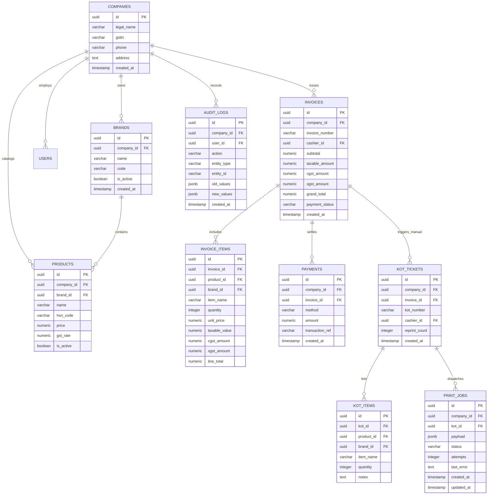

# Database Design Specification — Cafe Cloud POS

> **Important Note**: This document represents the blueprint and specification for the database. In accordance with project instructions, **no database tables or migrations are created at this stage**. Tables will be formally created in Phase 2 using a version-controlled PostgreSQL migration framework.

---

## 1. Design Principles & Conventions

1. **Relational Engine**: PostgreSQL 15+ utilizing ACID transactions for billing integrity.
2. **Multi-Company Scoping**: Every major table contains a `company_id UUID NOT NULL REFERENCES companies(id)`.
3. **Monetary Precision**: All currency amounts are defined as `NUMERIC(12, 2)` to avoid floating-point rounding errors. Tax rates are `NUMERIC(5, 2)`.
4. **Primary Keys**: UUID v4 (`UUID DEFAULT gen_random_uuid()`) for distributed scalability and obfuscation of business volume in IDs.
5. **Timezone Awareness**: All timestamps utilize `TIMESTAMP WITH TIME ZONE` (UTC stored at rest).
6. **Immutable Financial Invoices**: Completed invoice and invoice item records are never mutated in-place; modifications require void records and audit entries.

---

## 2. Entity-Relationship Diagram (ERD)



---

## 3. Relational Schema Specifications

### 3.1 `companies`
Stores legal entity information. All other data links to this table.
```sql
CREATE TABLE companies (
    id UUID PRIMARY KEY DEFAULT gen_random_uuid(),
    legal_name VARCHAR(150) NOT NULL,
    trade_name VARCHAR(150),
    gstin VARCHAR(15) NOT NULL UNIQUE,       -- 15-digit Indian GSTIN
    phone VARCHAR(20) NOT NULL,
    email VARCHAR(100),
    address TEXT NOT NULL,
    state_code VARCHAR(2) NOT NULL DEFAULT '32', -- e.g., Kerala '32'
    is_active BOOLEAN NOT NULL DEFAULT TRUE,
    created_at TIMESTAMP WITH TIME ZONE DEFAULT CURRENT_TIMESTAMP,
    updated_at TIMESTAMP WITH TIME ZONE DEFAULT CURRENT_TIMESTAMP
);
```

### 3.2 `brands`
Stores individual brand identities under the company (`Cafe Company` and `Brownie Shop`).
```sql
CREATE TABLE brands (
    id UUID PRIMARY KEY DEFAULT gen_random_uuid(),
    company_id UUID NOT NULL REFERENCES companies(id) ON DELETE RESTRICT,
    name VARCHAR(100) NOT NULL,              -- 'Cafe Company' or 'Brownie Shop'
    code VARCHAR(10) NOT NULL,               -- 'CC' or 'BS'
    description TEXT,
    is_active BOOLEAN NOT NULL DEFAULT TRUE,
    created_at TIMESTAMP WITH TIME ZONE DEFAULT CURRENT_TIMESTAMP,
    updated_at TIMESTAMP WITH TIME ZONE DEFAULT CURRENT_TIMESTAMP,
    CONSTRAINT uq_company_brand_code UNIQUE (company_id, code)
);
```

### 3.3 `users`
System operators with role-based access.
```sql
CREATE TABLE users (
    id UUID PRIMARY KEY DEFAULT gen_random_uuid(),
    company_id UUID NOT NULL REFERENCES companies(id) ON DELETE RESTRICT,
    username VARCHAR(50) NOT NULL,
    password_hash VARCHAR(255) NOT NULL,     -- Argon2id or bcrypt hash
    full_name VARCHAR(100) NOT NULL,
    role VARCHAR(20) NOT NULL CHECK (role IN ('ADMIN', 'STORE_MANAGER', 'CASHIER')),
    pin_code VARCHAR(6),                     -- Optional fast PIN login for tablet
    is_active BOOLEAN NOT NULL DEFAULT TRUE,
    created_at TIMESTAMP WITH TIME ZONE DEFAULT CURRENT_TIMESTAMP,
    updated_at TIMESTAMP WITH TIME ZONE DEFAULT CURRENT_TIMESTAMP,
    CONSTRAINT uq_company_username UNIQUE (company_id, username)
);
```

### 3.4 `categories`
Product categorization grouped by brand.
```sql
CREATE TABLE categories (
    id UUID PRIMARY KEY DEFAULT gen_random_uuid(),
    company_id UUID NOT NULL REFERENCES companies(id) ON DELETE RESTRICT,
    brand_id UUID NOT NULL REFERENCES brands(id) ON DELETE RESTRICT,
    name VARCHAR(100) NOT NULL,
    display_order INT NOT NULL DEFAULT 0,
    is_active BOOLEAN NOT NULL DEFAULT TRUE,
    created_at TIMESTAMP WITH TIME ZONE DEFAULT CURRENT_TIMESTAMP
);
```

### 3.5 `products`
Catalog items linked to brands with pricing and GST taxation rules.
```sql
CREATE TABLE products (
    id UUID PRIMARY KEY DEFAULT gen_random_uuid(),
    company_id UUID NOT NULL REFERENCES companies(id) ON DELETE RESTRICT,
    brand_id UUID NOT NULL REFERENCES brands(id) ON DELETE RESTRICT,
    category_id UUID NOT NULL REFERENCES categories(id) ON DELETE RESTRICT,
    name VARCHAR(120) NOT NULL,
    sku VARCHAR(50),
    hsn_code VARCHAR(10) NOT NULL DEFAULT '996331', -- Restaurant / takeaway service HSN
    price NUMERIC(12, 2) NOT NULL CHECK (price >= 0),
    gst_rate NUMERIC(5, 2) NOT NULL DEFAULT 5.00,   -- 5.00% GST
    is_tax_inclusive BOOLEAN NOT NULL DEFAULT TRUE,
    is_active BOOLEAN NOT NULL DEFAULT TRUE,
    created_at TIMESTAMP WITH TIME ZONE DEFAULT CURRENT_TIMESTAMP,
    updated_at TIMESTAMP WITH TIME ZONE DEFAULT CURRENT_TIMESTAMP,
    CONSTRAINT uq_company_product_sku UNIQUE (company_id, sku)
);
```

### 3.6 `invoices`
Consolidated fiscal invoice containing items from one or both brands.
```sql
CREATE TABLE invoices (
    id UUID PRIMARY KEY DEFAULT gen_random_uuid(),
    company_id UUID NOT NULL REFERENCES companies(id) ON DELETE RESTRICT,
    invoice_number VARCHAR(50) NOT NULL,     -- e.g. 'INV-2026-00001'
    cashier_id UUID NOT NULL REFERENCES users(id) ON DELETE RESTRICT,
    subtotal NUMERIC(12, 2) NOT NULL,
    discount_amount NUMERIC(12, 2) NOT NULL DEFAULT 0.00,
    taxable_amount NUMERIC(12, 2) NOT NULL,
    cgst_amount NUMERIC(12, 2) NOT NULL,
    sgst_amount NUMERIC(12, 2) NOT NULL,
    rounding_adjustment NUMERIC(6, 2) NOT NULL DEFAULT 0.00,
    grand_total NUMERIC(12, 2) NOT NULL,
    payment_status VARCHAR(20) NOT NULL CHECK (payment_status IN ('PAID', 'PARTIALLY_PAID', 'VOIDED')),
    notes TEXT,
    created_at TIMESTAMP WITH TIME ZONE DEFAULT CURRENT_TIMESTAMP,
    CONSTRAINT uq_company_invoice_number UNIQUE (company_id, invoice_number)
);
```

### 3.7 `invoice_items`
Snapshot of line items with exact historical pricing and brand assignment.
```sql
CREATE TABLE invoice_items (
    id UUID PRIMARY KEY DEFAULT gen_random_uuid(),
    invoice_id UUID NOT NULL REFERENCES invoices(id) ON DELETE CASCADE,
    product_id UUID NOT NULL REFERENCES products(id) ON DELETE RESTRICT,
    brand_id UUID NOT NULL REFERENCES brands(id) ON DELETE RESTRICT,
    item_name VARCHAR(120) NOT NULL,
    hsn_code VARCHAR(10) NOT NULL,
    quantity INT NOT NULL CHECK (quantity > 0),
    unit_price NUMERIC(12, 2) NOT NULL,
    discount_amount NUMERIC(12, 2) NOT NULL DEFAULT 0.00,
    taxable_value NUMERIC(12, 2) NOT NULL,
    gst_rate NUMERIC(5, 2) NOT NULL,
    cgst_rate NUMERIC(5, 2) NOT NULL,
    cgst_amount NUMERIC(12, 2) NOT NULL,
    sgst_rate NUMERIC(5, 2) NOT NULL,
    sgst_amount NUMERIC(12, 2) NOT NULL,
    line_total NUMERIC(12, 2) NOT NULL,
    notes TEXT
);
```

### 3.8 `payments`
Tender details for each transaction.
```sql
CREATE TABLE payments (
    id UUID PRIMARY KEY DEFAULT gen_random_uuid(),
    company_id UUID NOT NULL REFERENCES companies(id) ON DELETE RESTRICT,
    invoice_id UUID NOT NULL REFERENCES invoices(id) ON DELETE RESTRICT,
    payment_method VARCHAR(20) NOT NULL CHECK (payment_method IN ('CASH', 'UPI', 'CARD', 'SPLIT')),
    amount NUMERIC(12, 2) NOT NULL CHECK (amount > 0),
    tendered_amount NUMERIC(12, 2),          -- Cash given by customer
    change_returned NUMERIC(12, 2) DEFAULT 0.00, -- Cash change returned
    transaction_ref VARCHAR(100),            -- UPI UTR / Card Auth Code
    status VARCHAR(20) NOT NULL DEFAULT 'SUCCESS',
    created_at TIMESTAMP WITH TIME ZONE DEFAULT CURRENT_TIMESTAMP
);
```

### 3.9 `kot_tickets`
Created **only upon explicit manual button press** by cashier.
```sql
CREATE TABLE kot_tickets (
    id UUID PRIMARY KEY DEFAULT gen_random_uuid(),
    company_id UUID NOT NULL REFERENCES companies(id) ON DELETE RESTRICT,
    invoice_id UUID NOT NULL REFERENCES invoices(id) ON DELETE RESTRICT,
    kot_number VARCHAR(30) NOT NULL,         -- e.g. 'KOT-2026-00001'
    cashier_id UUID NOT NULL REFERENCES users(id) ON DELETE RESTRICT,
    is_reprint BOOLEAN NOT NULL DEFAULT FALSE,
    reprint_count INT NOT NULL DEFAULT 0,
    created_at TIMESTAMP WITH TIME ZONE DEFAULT CURRENT_TIMESTAMP,
    CONSTRAINT uq_company_kot_number UNIQUE (company_id, kot_number)
);
```

### 3.10 `kot_items`
Food preparation line items sent to the kitchen.
```sql
CREATE TABLE kot_items (
    id UUID PRIMARY KEY DEFAULT gen_random_uuid(),
    kot_id UUID NOT NULL REFERENCES kot_tickets(id) ON DELETE CASCADE,
    product_id UUID NOT NULL REFERENCES products(id) ON DELETE RESTRICT,
    brand_id UUID NOT NULL REFERENCES brands(id) ON DELETE RESTRICT,
    item_name VARCHAR(120) NOT NULL,
    quantity INT NOT NULL CHECK (quantity > 0),
    preparation_notes TEXT                   -- e.g. "Less ice", "Warm brownie"
);
```

### 3.11 `print_jobs`
Asynchronous job queue consumed by the local Node.js print agent.
```sql
CREATE TABLE print_jobs (
    id UUID PRIMARY KEY DEFAULT gen_random_uuid(),
    company_id UUID NOT NULL REFERENCES companies(id) ON DELETE RESTRICT,
    kot_id UUID NOT NULL REFERENCES kot_tickets(id) ON DELETE CASCADE,
    printer_target VARCHAR(50) NOT NULL DEFAULT 'KITCHEN_WIFI',
    payload JSONB NOT NULL,                  -- Formatted ticket text and metadata
    status VARCHAR(20) NOT NULL DEFAULT 'PENDING' CHECK (status IN ('PENDING', 'PROCESSING', 'COMPLETED', 'FAILED')),
    attempts INT NOT NULL DEFAULT 0,
    last_error TEXT,
    created_at TIMESTAMP WITH TIME ZONE DEFAULT CURRENT_TIMESTAMP,
    updated_at TIMESTAMP WITH TIME ZONE DEFAULT CURRENT_TIMESTAMP
);
```

### 3.12 `audit_logs`
Immutable audit trail for financial accountability.
```sql
CREATE TABLE audit_logs (
    id UUID PRIMARY KEY DEFAULT gen_random_uuid(),
    company_id UUID NOT NULL REFERENCES companies(id) ON DELETE RESTRICT,
    user_id UUID REFERENCES users(id) ON DELETE SET NULL,
    action VARCHAR(50) NOT NULL,             -- 'BILL_VOIDED', 'KOT_REPRINTED', 'PRICE_CHANGED'
    entity_type VARCHAR(50) NOT NULL,        -- 'INVOICE', 'KOT', 'PRODUCT'
    entity_id VARCHAR(50) NOT NULL,
    old_values JSONB,
    new_values JSONB,
    ip_address VARCHAR(45),
    created_at TIMESTAMP WITH TIME ZONE DEFAULT CURRENT_TIMESTAMP
);
```

---

## 4. Key Indexes for High-Speed Counter Operations

```sql
-- Fast invoice lookups by date range for daily reports
CREATE INDEX idx_invoices_company_created ON invoices (company_id, created_at);

-- Fast brand-wise breakdown queries on invoice items
CREATE INDEX idx_invoice_items_brand ON invoice_items (brand_id, invoice_id);

-- Print agent job queue polling index (critical for sub-second pickup)
CREATE INDEX idx_print_jobs_pending ON print_jobs (company_id, status, created_at)
WHERE status = 'PENDING';

-- Fast product search by brand
CREATE INDEX idx_products_brand_active ON products (company_id, brand_id, is_active);
```
